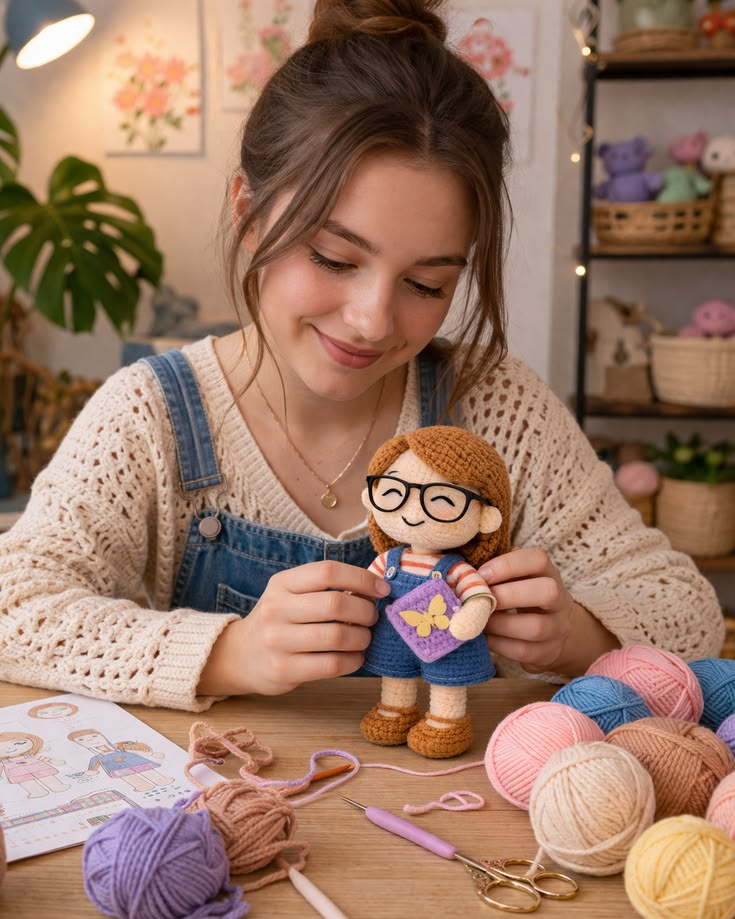
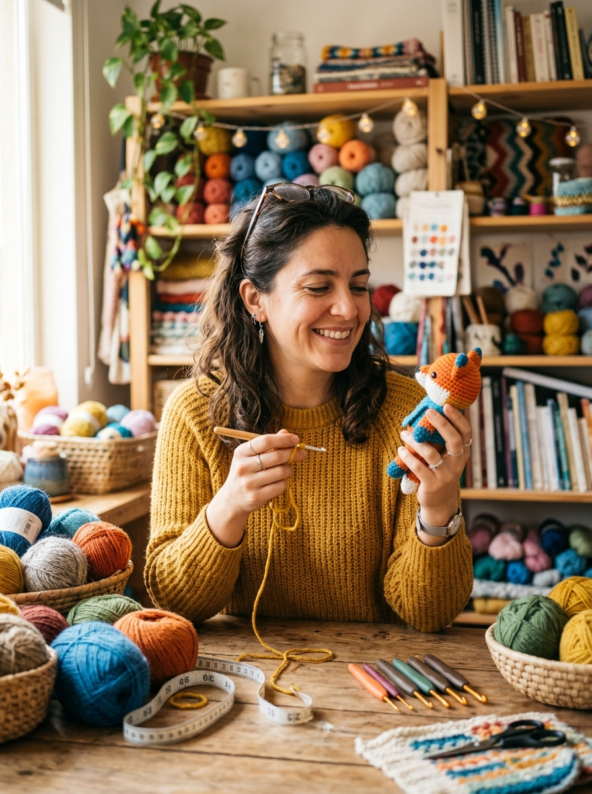

# Proto-persona — Kataa Tejidos

> Guía: [Proto-persona](../evaluacion/guias/fase-1-requerimientos/02-proto-persona.md)

## Proto-persona principal

**Tamara, 24 años.** Estudiante de Diseño Gráfico.

> "Me gusta regalar detalles a mis amigos, pero ya se me acaban las ideas."

### Comportamientos

- Sigue activamente a múltiples emprendimientos en Instagram y TikTok dedicados a artesanías, colecciones, figuras, cerámica y diseño para descubrir ideas de regalos.
- Guarda y organiza las opciones que le gustan en carpetas dentro de cada red social con el nombre "Regalos originales".
- Cuando se le acaban las ideas de regalos, recurre a Pinterest para inspirarse y busca publicaciones con respecto a conceptos llamativos.
- Prefiere las compras presenciales: visita tiendas, bazares y ferias en sus tardes libres hasta las 18:00 hrs.
- A partir de las 20:00 hrs, realiza las compras que no alcanzó de forma presencial por internet desde su computador; compra para todos sus amigos o los regalos que encuentre para cada uno sin preocuparse del costo de envío.

### Necesidades

- Encontrar regalos inigualables, originales y llamativos que se salgan de lo común o tradicional.
- Explorar un catálogo con amplia variedad de productos para comparar y seleccionar opciones únicas.
- Brindar a sus amigos en ocasiones especiales un recuerdo significativo que no se les olvide y que perdure por mucho tiempo.
- Saber que el producto proviene de un lugar seguro y confiable, sin tener que preocuparse por la calidad de confección ni por el envío.
- Contar con especificaciones claras de personalización, materiales y dimensiones antes de comprar.

### Motivaciones

- Tener miles de opciones y variedad de diseños en un solo lugar.
- Optimizar su tiempo y no tener que pasar horas buscando productos en múltiples sitios.
- Tener la confianza y cercanía para pedir exactamente lo que desea en el producto personalizado ("pedir mi deseo en el producto").
- Dejar una huella emocional entregando un detalle hecho a mano y con dedicación.

### Frustraciones

- Tiempos de demora o confección prolongados que arriesguen no llegar a tiempo para la ocasión especial.
- Temor a que el amigurumi terminado no sea el trabajo que ella esperaba o no coincida con el acabado prometido.
- Falta de información o confusión con las medidas y dimensiones, con riesgo de equivocarse de tamaño.
- No poder filtrar o buscar opciones por categorías, temáticas o tipos de amigurumi en la tienda online.
- Tener que comprar empaque de regalo aparte porque el producto no viene empacado ni presentado para la ocasión.

<!-- Segunda proto-persona (opcional): copia la estructura de arriba. -->

## Proto-persona 2

**Ignacia, 29 años.** Publicista.

> "Cada patrón es una nueva oportunidad para crear algo único con mis propias manos."

### Comportamientos

- Busca patrones de amigurumis en Instagram, Etsy, Patronix y otras plataformas digitales de tejido.
- Compra patrones en formato PDF para seguir instrucciones paso a paso.
- Guarda y organiza los diseños que le gustan para tejerlos en su tiempo libre y fines de semana.
- Compara precios, diseños y opiniones de otras tejedoras antes de realizar una compra.
- Utiliza su teléfono celular para descargar y consultar los patrones mientras teje.

### Necesidades

- Patrones originales, atractivos y diferentes que destaquen por su propuesta de diseño.
- Instrucciones claras, detalladas y fáciles de seguir, con nomenclatura comprensible.
- Fotografías de referencia para cada etapa del tejido y ensamblaje de las piezas.
- Información precisa sobre materiales requeridos (hilos, grosores, aguja), medidas finales y nivel de dificultad.
- Un proceso de compra sencillo, pasarela de pago segura y acceso rápido/descarga inmediata a sus archivos PDF.

### Motivaciones

- Desarrollar su creatividad y mejorar continuamente sus habilidades en la técnica del crochet.
- Aprender nuevas técnicas, puntos y asumir desafíos con proyectos de mayor elaboración.
- Crear regalos personalizados y piezas únicas con sus propias manos.
- Disfrutar del tejido como un pasatiempo relajante, terapéutico y satisfactorio.
- Explorar en el mediano plazo la posibilidad de comercializar sus propias creaciones terminadas.

### Frustraciones

- Patrones con instrucciones confusas, abreviaciones poco claras o explicaciones incompletas.
- Diseños demasiado comunes, repetitivos o con poca originalidad en el mercado.
- Falta de fotografías que orienten el proceso paso a paso y el armado final.
- Comprar un patrón y descubrir que es difícil de entender o que no coincide con su nivel técnico.
- Procesos de compra complicados, enlaces caídos o problemas al momento de descargar los archivos PDF adquiridos.