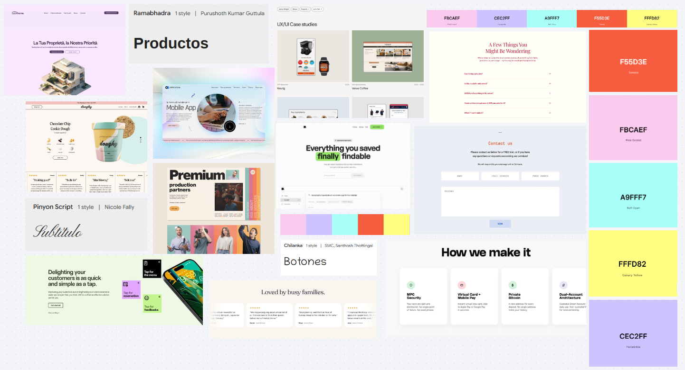

# Moodboard — Kataa Tejidos

> Guía: [Moodboard](../evaluacion/guias/fase-2-specs/02-moodboard.md)

**Tablero en Whimsical:** [https://whimsical.com/katalina-s-workspace/moodboard-Nf3gjQVAcxYUmQ2UALoU1P@6HYTAunKLgTTsMYSSdp6WvLCpcU6DoycLQf2voNDUnSPN1f]

### Captura del Moodboard

## Palabras clave

Minimalismo - Calidez - Confianza - Calidad - Seguridad

## Qué sensación buscamos

Buscamos transmitir una sensación de **calidez, confianza, seguridad y calidad**, reflejando el cariño y la dedicación que hay detrás de cada producto. Esta estética **minimalista**, acogedora y ordenada conecta directamente con **Tamara (Proto-persona principal)** al facilitarle una experiencia de encargo clara, ordenada y sin fricciones; y con **Ignacia (Proto-persona secundaria)**, al brindarle un espacio acogedor y estructurado para consultar información técnica, guías y contenido de su interés.
