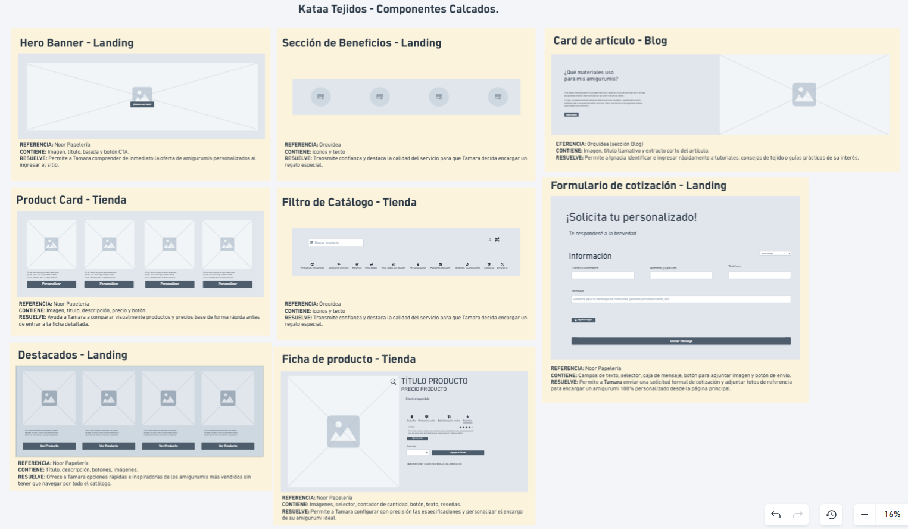

# Componentes — Kataa Tejidos

> Guía: [Componentes](../evaluacion/guias/fase-2-specs/03-calco-de-componentes.md)

**Tablero en Whimsical:** [https://whimsical.com/katalina-s-workspace/6S1JSGv3jEDiXViy3Fmmvs@6HYTAunKLgTXEqD9HKbpNseCurD2qr3FACNvn38EAK3Ri2h](https://whimsical.com/katalina-s-workspace/6S1JSGv3jEDiXViy3Fmmvs@6HYTAunKLgTXEqD9HKbpNseCurD2qr3FACNvn38EAK3Ri2h)

### Captura de componentes calcados

<!-- Mínimo 6 componentes que cubran landing, blog y tienda. -->

| Componente | Referencia | Qué contiene | Qué necesidad resuelve |
|---|---|---|---|
| **Hero Banner** *(Landing)* | Noor Papelería | Imagen destacada de bienvenida, título principal con propuesta de valor, bajada explicativa, botón de llamado a la acción (*CTA*) e íconos de ventajas rápidas. | Permite a **Tamara** comprender de inmediato la oferta de amigurumis personalizados y la motiva a explorar la tienda sin fricciones. |
| **Sección de Beneficios** *(Landing)* | Orquídea | Bloque horizontal de 4 columnas con íconos vectoriales simples (envíos a todo Chile, empaque de regalo, 100% artesanal, pago seguro) y frases cortas. | Transmite la **calidad y dedicación** del producto a **Tamara**, dándole confianza para realizar un encargo personalizado para regalar. |
| **Carrusel de Destacados** *(Landing)* | Noor Papelería | Título de sección (*"Los más pedidos"*), botones de navegación lateral (*< >*) y fila de tarjetas de productos más populares o destacados. | Le muestra a **Tamara** rápidamente las opciones más populares para inspirarse sin tener que explorar todo el catálogo desde el inicio. |
| **Product Card** *(Tienda)* | Noor Papelería | Foto del producto, título claro, muestras de colores disponibles en círculos, precio en CLP y botón para ver más opciones. | Ayuda a **Tamara** a comparar rápidamente los productos disponibles y revisar sus precios base de forma visual antes de ingresar al detalle. |
| **Ficha de Producto / Selector** *(Tienda)* | Noor Papelería | Galería de imágenes, selector de colores/variantes en círculos, contador de cantidad, botón de agregar al carro y pestañas desplegables (*accordion*) con detalles y reseñas de compradora. | Le permite a **Tamara** configurar con precisión las especificaciones de su encargo y revisar experiencias reales de otras compradoras en un solo lugar. |
| **Filtros de Catálogo** *(Tienda)* | Noor Papelería / Revesderecho | Menú y botones/chips superiores para filtrar por categorías (colores, tipo de producto, disponibilidad, lana/patrón). | Facilita a **Ignacia** encontrar de forma directa los patrones digitales o insumos específicos que busca sin perder tiempo navegando todo el sitio. |
| **Card de Artículo** *(Blog)* | Noor Papelería / Blog editorial | Imagen destacada del artículo, etiqueta de categoría (*Crochet*, *Guías*), título llamativo y breve extracto explicativo. | Le permite a **Ignacia** identificar e ingresar rápidamente a tutoriales, consejos de tejido o guías prácticas que le resulten de utilidad. |
| **Formulario de Cotización / Contacto** *(Landing / Contacto)* | Noor Papelería | Campos de entrada para datos personales (nombre, email), selector de tipo de encargo, caja de mensaje, botón para adjuntar foto de referencia y botón de envío (*Submit*). | Permite a **Tamara** solicitar un presupuesto a medida y adjuntar referencias visuales para encargar su amigurumi 100% personalizado desde la portada. |
