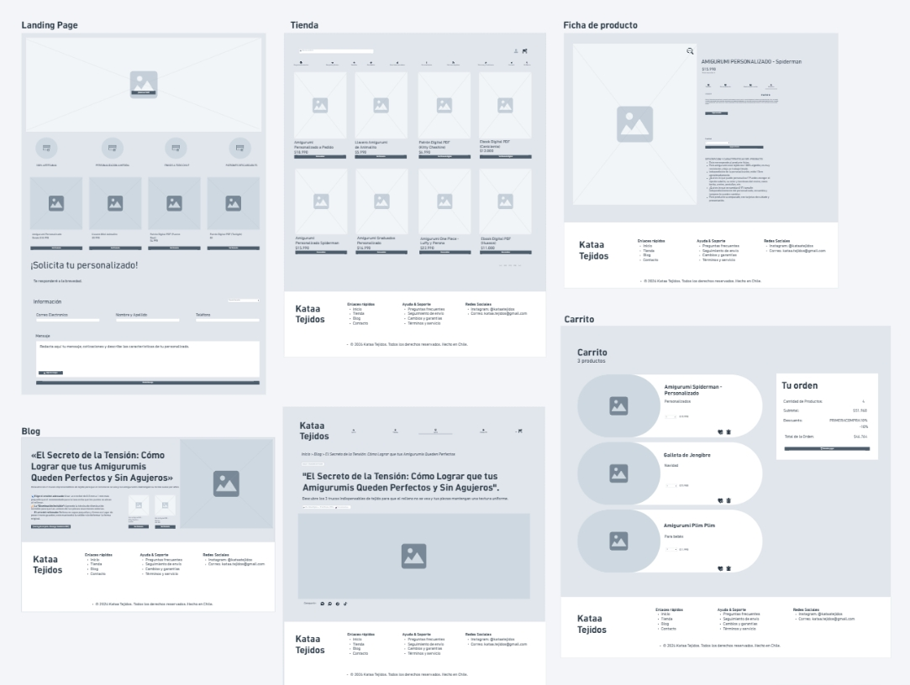

# Spec de diseño — [Kataa Tejidos]

> Guía: [Spec de diseño](../evaluacion/guias/fase-2-specs/06-spec-de-diseno.md)

La spec de diseño tiene dos partes:

1. **[`DESIGN.md`](../DESIGN.md)** (en la raíz): tu design system, en el formato que Stitch importa.
2. **Este documento:** tus pantallas, escritas como prompts listos para pegar en Stitch.

**Wireframes en Whimsical:** [https://whimsical.com/trabajo-duoc/wireframes-3SGmMg35aeccpo3D5BHg9P@6HYTAunKLgTXUhgiBXb3vL2vqEp12tE9FxyeNGH6Djp9SBo]

> Guía de wireframes: [Wireframes](../evaluacion/guias/fase-2-specs/04-wireframes.md)

Captura de los wireframes: 

## Pantallas

<!-- Un prompt por pantalla. Cada uno con: pantalla y dispositivo, objetivo
de tu proto-persona, componentes de arriba hacia abajo (con los nombres de
tu DESIGN.md) y textos y datos reales. -->

### 1. Landing

```text
Pantalla: Landing de Kataa Tejidos, versión desktop. Usa el design system del proyecto.
Objetivo: Captar la atención de Tamara mostrándole la propuesta de valor de amigurumis hechos a mano en Chile, productos destacados y opción de pedidos personalizados.
Componentes, de arriba hacia abajo:
1. Navbar: Logo "Kataa Tejidos", enlaces (Inicio, Tienda, Blog, Contacto), botón de carrito e ícono de búsqueda.
2. Hero Banner: Titular "Amigurumis y tejidos hechos a mano con amor en Chile", subtítulo explicativo, imagen destacada de amigurumi de alta calidad y botón CTA "Explorar Tienda".
3. Sección de Beneficios: 4 columnas con íconos (100% Artesanal, Diseños Personalizados, Envíos a todo Chile, Patrones Digitales PDF).
4. Carrusel de Productos Destacados: Fila horizontal con 4 Product Cards ("Puerco Real Amigurumi" $18.990 CLP, "Llavero Capibara" $5.990 CLP, "Kit Inicial Crochet" $12.990 CLP, "Patrón Digital Puerco Real" $4.990 CLP) con flechas de navegación lateral.
5. Formulario de Cotización Especial: Campos de texto para Nombre, Email, Tipo de encargo (Desplegable) y botón "Solicitar Cotización".
6. Footer: Logo, enlaces rápidos, redes sociales (@kataatejidos), correo de contacto y copyright.
```

### 2. Tienda

```text
Pantalla: Tienda de Kataa Tejidos, versión desktop. Usa el design system del proyecto.
Objetivo: Permitir a Ignacia filtrar y explorar cómodamente todo el catálogo de productos físicos y patrones digitales con precios en CLP.
Componentes, de arriba hacia abajo:
1. Navbar.
2. Breadcrumbs: Inicio > Tienda.
3. Cabecera de Catálogo: Título "Nuestra Tienda" y selector de ordenamiento ("Ordenar por: Más populares / Menor precio").
4. Área Principal (Layout 2 columnas):
   - Columna Izquierda (Filtros): Categorías ([x] Todos, [ ] Amigurumis, [ ] Llaveros, [ ] Patrones PDF, [ ] Kits).
   - Columna Derecha (Grilla de Productos): 6 Product Cards dispuestas en grilla de 3 columnas x 2 filas con foto, título, selector de color, precio en CLP y botón "Ver detalles".
5. Paginación: Botones centrados [ ‹ ] [ 1 ] [ 2 ] [ 3 ] [ › ].
6. Footer.
```

### 3. Ficha de producto

```text
Pantalla: Ficha de producto de Kataa Tejidos, versión desktop. Usa el design system del proyecto.
Objetivo: Entregar información detallada del producto "Puerco Real Amigurumi", opciones de personalización y botón directo para agregar al carrito.
Componentes, de arriba hacia abajo:
1. Navbar.
2. Breadcrumbs: Inicio > Tienda > Amigurumis > Puerco Real Amigurumi.
3. Bloque Principal de Producto (2 columnas):
   - Columna Izquierda: Galería de imágenes (1 imagen principal grande + fila inferior de 3 miniaturas).
   - Columna Derecha: Título "Puerco Real Amigurumi", valoración 5 estrellas (12 reseñas), precio $18.990 CLP, selector de variantes de color (círculos interactivos), selector de cantidad [ - 1 + ], botón principal "Agregar al Carrito" y botón secundario "Cotizar por WhatsApp".
4. Acordeón de Información: Secciones colapsables para "Descripción del producto", "Tiempos de confección y envío" y "Cuidados y lavado".
5. Sección de Productos Relacionados: Carrusel con 3 Product Cards sugeridas.
6. Footer.
```

### 4. Carrito

```text
Pantalla: Carrito de Kataa Tejidos, versión desktop. Usa el design system del proyecto.
Objetivo: Mostrar el resumen claro de la compra, desglose de costos en CLP y facilitar la revisión antes de ir al pago.
Componentes, de arriba hacia abajo:
1. Navbar.
2. Breadcrumbs: Inicio > Carrito.
3. Tabla de Resumen de Compra:
   - Filas de productos con miniatura, nombre, precio unitario, selector de cantidad y botón eliminar.
4. Bloque de Cupón y Envío: Campo para código de descuento + selector de región de envío en Chile.
5. Tarjeta de Resumen de Pago: Subtotal, Costo de envío, Total final en CLP y botón principal "Proceder al Pago".
```

### 5. Blog

```text
Pantalla: Blog de Kataa Tejidos, versión desktop. Usa el design system del proyecto.
Objetivo: Ofrecer un espacio de contenidos sobre técnicas de crochet para enganchar a la comunidad tejedora e impulsar la venta de patrones.
Componentes, de arriba hacia abajo:
1. Navbar (con la opción "Blog" resaltada).
2. Header de Blog: Título "El Blog de Kataa Tejidos" y subtítulo "Consejos, guías y tutoriales de tejido amigurumi".
3. Grilla de Artículos: 4 tarjetas de blog con imagen de portada, etiqueta de categoría, título, extracto de texto, fecha y enlace "Leer artículo".
4. Paginación: [ ‹ ] [ 1 ] [ 2 ] [ › ].
5. Footer.
```

### 6. Artículo

```text
Pantalla: Artículo del blog de Kataa Tejidos, versión desktop. Usa el design system del proyecto.
Objetivo: Guiar a Ignacia mediante un tutorial paso a paso ("El Secreto de la Tensión") y realizar venta cruzada hacia los patrones PDF y kits de la tienda.
Componentes, de arriba hacia abajo:
1. Navbar.
2. Breadcrumbs: Inicio > Blog > El Secreto de la Tensión.
3. Encabezado del Artículo: Etiqueta de categoría "Guías y Consejos", título principal H1 "El Secreto de la Tensión: Cómo Lograr que tus Amigurumis Queden Perfectos", bajada resumida, datos de autoría ("Por Kataa Tejidos • 12 Oct, 2026 • 5 min de lectura") y botones de compartir.
4. Imagen Principal / Cover: Fotografía en alta resolución de la trama del tejido.
5. Cuerpo de Lectura: Párrafos explicativos, puntos clave explicados, cuadro destacado (pull-quote) con truco de tejido.
6. Módulo de Venta Cruzada (Cross-Selling): Título "¿Quieres practicar esta técnica?" con 2 Mini Product Cards ("Patrón Digital PDF" $4.990 CLP y "Kit Inicial Crochet" $12.990 CLP).
7. Sección de Artículos Relacionados: 2 tarjetas de lectura sugeridas.
8. Footer.
```

### Versión mobile (para cada pantalla)

```text
Genera la versión mobile (375px de ancho) de esta pantalla siguiendo la sección Layout del design system:
- Transforma la Navbar desktop en un header mobile compacto con menú tipo Hamburguesa (☰), Logo centrado e Ícono de Carrito.
- Apila todos los contenedores de 2 o más columnas en un layout vertical de 1 sola columna.
- Convierte las grillas de productos en carruseles táctiles con scroll horizontal o apilamiento vertical.
- Mantiene todos los textos reales, precios en CLP, botones y pie de página accesibles en pantalla reducida.
```
