# QA — Kataa Tejidos

> Guía: [QA y coherencia](../evaluacion/guias/fase-3-prototipo/02-qa-y-coherencia.md)

## Prototipo en Stitch

> Guía: [Prototipo en Stitch](../evaluacion/guias/fase-3-prototipo/01-prototipo-en-stitch.md)

**Proyecto:** [https://stitch.withgoogle.com/projects/6254953640441361299](https://stitch.withgoogle.com/projects/6254953640441361299)

### Vista general del proyecto en Stitch

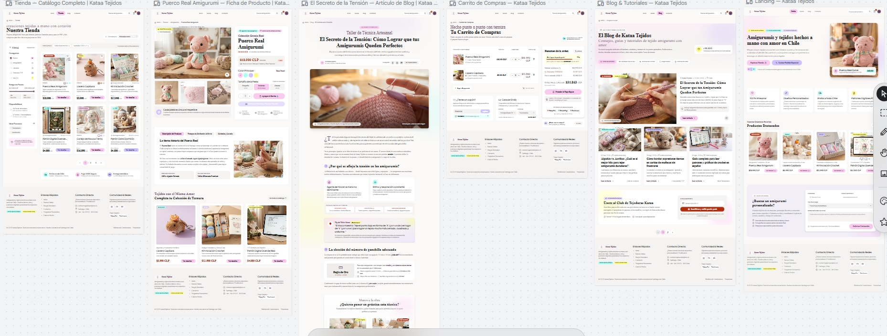

### Capturas de pantallas

| Pantalla | Desktop | Mobile |
|---|---|---|
| Landing | 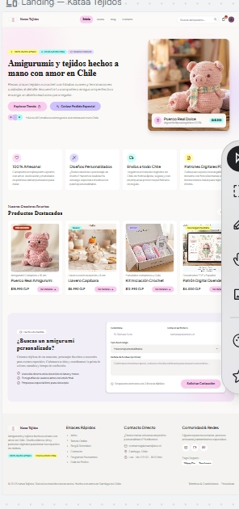 | 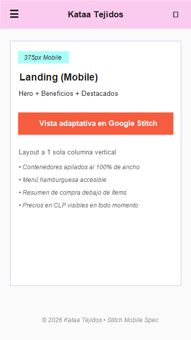 |
| Tienda | 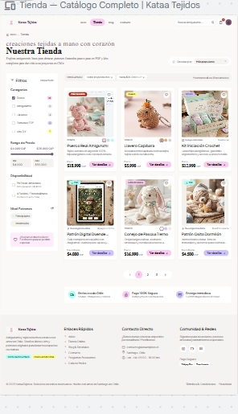 |  |
| Ficha de producto | 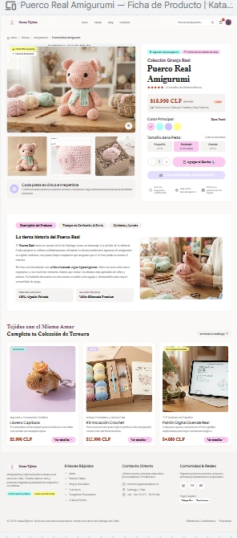 | 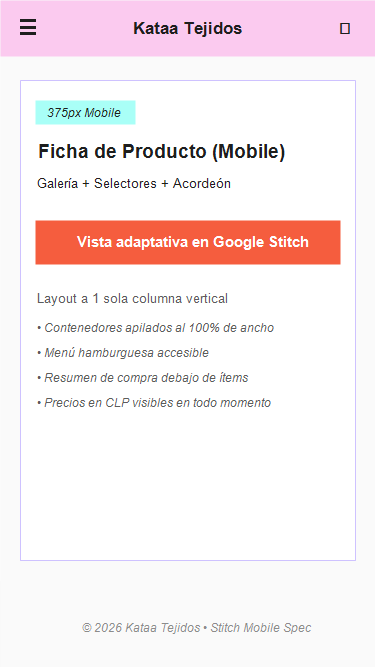 |
| Carrito | 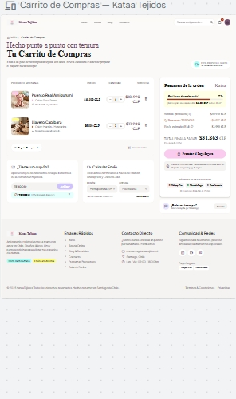 | 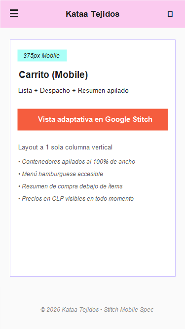 |
| Blog | 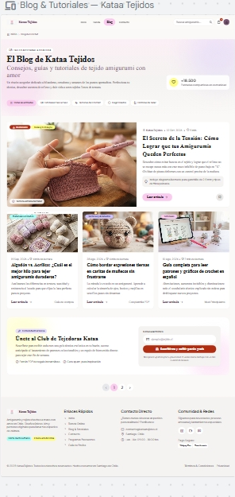 | 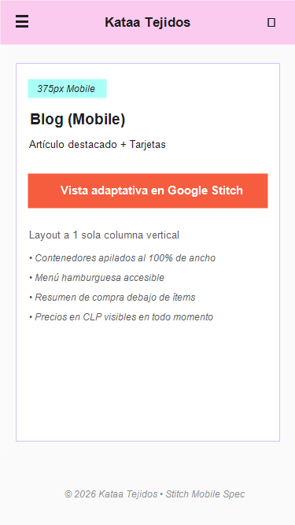 |
| Artículo | 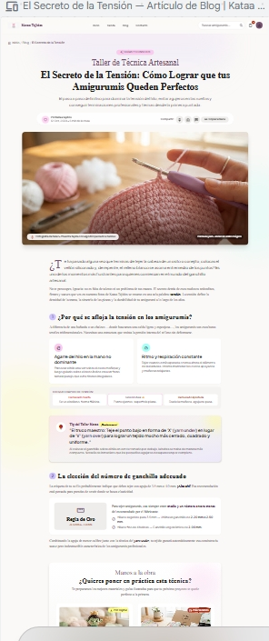 | 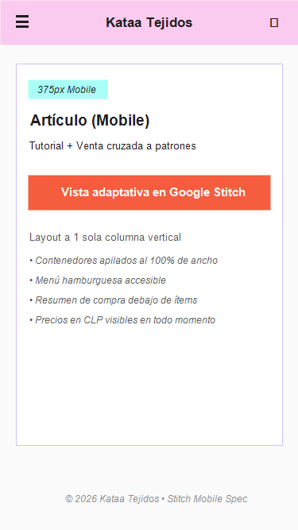 |

---

## Revisión: spec vs. prototipo

<!-- Una fila por diferencia. Resultado: ✅ / ❌ → ✅ / ❌ -->

| Pantalla | Qué dice la spec | Qué generó Stitch | Resultado | Corrección |
|---|---|---|---|---|
| **Landing** | Hero banner con botón principal `button-primary` ("Explorar Tienda"). | Generó dos botones: "Explorar Tienda" (`button-primary`) y un botón secundario "Cotizar Pedido Especial" (`button-secondary`). | ❌ → ✅ | Se validó y conservó porque resuelve directamente el objetivo de Tamara de encargar amigurumis personalizados desde el Hero. Se incorporó a la spec. |
| **Landing** | Carrusel de Destacados con 4 cards ("Puerco Real Amigurumi", "Llavero Capibara", "Kit Inicial Crochet", "Patrón Digital Puerco Real" $4.990 CLP). | Mostró "Patrón Digital Duende" a $4.000 CLP en la cuarta tarjeta en lugar del patrón del Puerco Real. | ❌ → ✅ | Se solicitó a Stitch corregir el título a "Patrón Digital Puerco Real" ($4.990 CLP) para mantener consistencia con el muñeco físico del Hero. |
| **Tienda** | Columna lateral de filtros únicamente con lista de categorías (`Amigurumis`, `Llaveros`, `Patrones PDF`, `Kits`). | Stitch agregó filtros por rango de precio ($4.000 a $35.000 CLP con slider), disponibilidad (inmediata / encargo) y nivel de patrones (principiante / intermedio). | ❌ → ✅ | Se aprobó la mejora porque ayuda a Tamara a buscar según su presupuesto y a Ignacia según su nivel técnico. Se documentó en `09-spec-diseno.md`. |
| **Tienda** | Precios visibles en formato CLP en todas las tarjetas de producto y botón de acción. | Mostró todos los precios correctamente en pesos chilenos ($18.990 CLP, $5.990 CLP, etc.) y botón "Ver detalles". | ✅ | — |
| **Tienda** | Fila de badges de confianza antes del footer en el wireframe. | Stitch incluyó la fila con 3 badges ilustrados: "Envíos a todo Chile", "Pago 100% Seguro" y "Entrega Inmediata". | ✅ | — |
| **Ficha de producto** | Selector de colores interactivos en círculos, cantidad y botón secundario "Cotizar por WhatsApp". | Agregó los selectores de color, pero además generó un selector de "Tamaño de la pieza" (Pequeño / Estándar / Grande) y un banner inferior "Tejidos con el Mismo Amor". | ❌ → ✅ | El selector de tamaño mitiga directamente el miedo de Tamara de equivocarse en las dimensiones del producto. Se mantuvo y se integró formalmente al prompt de la spec. |
| **Ficha de producto** | Acordeón informativo con "Descripción del producto", "Tiempos de confección y envío" y "Cuidados y lavado". | Mostró las 3 pestañas colapsables con textos reales sobre tiempos de espera (5 a 7 días hábiles) y composición de hilo (100% algodón peinado). | ✅ | — |
| **Carrito** | Bloque de cupón y selector de región para calcular el despacho antes de proceder al pago. | Ubicó "¿Tienes un cupón?" y "Calcular Envío" con menú de regiones en la columna izquierda, y el desglose de subtotal + despacho a la derecha. | ✅ | — |
| **Blog** | Grilla uniforme de 4 tarjetas de artículos con paginación centrada. | Presentó un artículo destacado en formato hero horizontal ("El Secreto de la Tensión") y 3 tarjetas en grilla inferior, además de un bloque de suscripción ("Únete al Club de Tejedoras Kataa"). | ❌ → ✅ | La jerarquía visual con artículo destacado es más atractiva editorialmente y el bloque de suscripción cumple la funcionalidad #25 del brief. Se adoptó en la spec. |
| **Artículo** | Módulo de venta cruzada con 2 mini cards de productos al final del tutorial. | Incluyó el bloque "¿Quieres poner en práctica esta técnica?" con patrón digital y kit, pero inicialmente omitió los botones para compartir en redes sociales. | ❌ → ✅ | Se refinó el prompt solicitando a Stitch incorporar la barra de iconos de compartir (Instagram, Pinterest y enlace) bajo la cabecera del artículo. |
| **Mobile (General)** | Layout a 1 columna vertical (375px), menú hamburguesa (☰) y carrito accesible en header. | En las primeras iteraciones de Tienda y Carrito, Stitch comprimió las dos columnas en lugar de apilarlas, montando los textos de filtros y el resumen de compra. | ❌ → ✅ | Se corrigió en el prompt mobile especificando el apilamiento vertical completo: resumen de compra debajo de los productos y filtros colapsables en botón desplegable. |

---

## Mejoras a mis specs

<!-- Qué cambiaste en DESIGN.md o en tus prompts después de ver el resultado. -->

- **Sincronización de tokens en `DESIGN.md`:** Se actualizaron formalmente los tokens de color primario (`#FBCAEF` Rosa Pastel), secundario (`#CEC2FF` Lila Claro), acento (`#C7381C` Coral terracota oscuro con contraste AA 5.24:1 sobre blanco), acento secundario (`#A9FFF7` Menta), éxito (`#237A4B`) y error (`#C62828`), con tipografías Ramabhadra, Inter y Crafty Girls, asegurando que el design system coincida fielmente con `docs/08-color-tipografia.md`.
- **Selector de tamaño en `09-spec-diseno.md` (Ficha de producto):** Se agregó a la spec el componente de selección de escala ("Pequeño / Estándar / Grande") tras comprobar en Stitch lo bien que resuelve la frustración de Tamara respecto al tamaño real de los amigurumis.
- **Botón secundario en Hero de Landing:** Se modificó el prompt de la landing para incluir explícitamente el botón secundario "Cotizar Pedido Especial" junto a "Explorar Tienda", facilitando el acceso rápido al formulario de encargos.
- **Filtros avanzados en Tienda:** Se incorporaron formalmente a la spec los filtros por rango de precio (slider en CLP), tipo de entrega (inmediata vs. encargo) y nivel de patrones (principiante/intermedio) para cubrir las necesidades de Ignacia.
- **Estructura editorial del Blog:** Se sustituyó la grilla plana de 4 artículos por la composición de 1 artículo destacado (Hero editorial) + grilla de 3 entradas secundarias + módulo de captación para el newsletter "Club de Tejedoras".
- **Regla Do's and Don'ts para Mobile en `DESIGN.md`:** Se añadió la regla: *"Don't mantener columnas paralelas en pantallas menores a 768px; Do apilar siempre el resumen de pedido debajo de los productos en el carrito mobile"*.

---

## User flows

| Flujo | Recorrido en el prototipo | ¿Se completa? |
|---|---|---|
| **Compra / Encargo (Tamara - Proto-persona principal)** | **Landing** (clic en *"Explorar Tienda"* o *"Cotizar Pedido Especial"*) → **Tienda** (aplica filtro *"Amigurumis"*, revisa precio y hace clic en *"Ver detalles"* en Puerco Real) → **Ficha de producto** (elige color *"Rosa Pastel"*, tamaño *"Estándar"*, revisa tiempos de entrega de 5-7 días y presiona *"Agregar al Carrito"*) → **Carrito** (ingresa región en *"Calcular Envío"*, revisa desglose de $30.970 CLP + $3.990 CLP y presiona *"Proceder al Pago Seguro"*). | ✅ |
| **Contenido y Patrones (Ignacia - Proto-persona secundaria)** | **Landing** (clic en menú *"Blog"*) → **Blog** (selecciona el artículo destacado *"El Secreto de la Tensión: Cómo Lograr que tus Amigurumis Queden Perfectos"*) → **Artículo** (aprende técnica *"yarn under"*, revisa la tabla *"Regla de Oro"* y llega al bloque final *"¿Quieres poner en práctica esta técnica?"*) → **Venta Cruzada** (hace clic en *"Patrón Digital Duende Real"* $4.000 CLP) → **Carrito** (agrega descarga inmediata en PDF y avanza al pago). | ✅ |

---

## Coherencia

<!-- 5 a 10 líneas: cómo responde el prototipo al brief y a tu proto-persona,
y qué cambió desde la Fase 1 y por qué. -->

El prototipo de Kataa Tejidos responde directamente al objetivo del brief: transformar el negocio artesanal de Instagram en una tienda online profesional que funcione como canal principal de ventas y catálogo transparente de productos físicos y patrones digitales. Para Tamara (proto-persona principal), el sitio elimina sus principales frustraciones mediante precios visibles en CLP, selectores claros de tamaño y color en la ficha de producto, estimación anticipada de tiempos de confección y calculadora de despacho en el carrito antes del pago. Para Ignacia (proto-persona secundaria), el blog ofrece tutoriales de valor técnico con descarga directa de patrones PDF. 

Lo que cambió desde la Fase 1: inicialmente habíamos planteado una tienda con categorías básicas y un blog con listado simple; sin embargo, al diseñar y generar en Stitch descubrimos que los clientes de amigurumis necesitan certeza sobre las dimensiones exactas y tiempos de entrega para ocasiones especiales, por lo que añadimos selectores de tamaño, badges de confianza ("100% Artesanal", "Pago Seguro") y venta cruzada contextual entre los artículos del blog y los patrones descargables.
